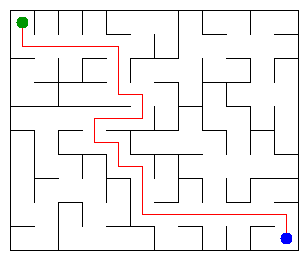

# Assignment 3. Maze Escape

Student ID: 250877
Name: Alan Beisen
Group: B057 (SE 2541)
Maze size (rows x columns): 10 x 12

This file is the report. Fill it in as you go. How to start: `START_HERE.md`. The task: `docs/Assignment3.pdf`.

## Program output

The 13 lines your program prints on your data (`java -cp out Main`):

    Broken: 119
    Kept: 99
    Last broken wall: 202
    MST cost: 34567
    Heaviest broken wall: 843
    Path length: 24
    DFS visited: 81
    Dead ends: 43
    Zones: 8
    Largest zone: 24
    Is DAG: 0
    Flow stages: 6
    Fastest route cost: 12

My maze:

## Questions

Answer in your own words, two or three sentences each.

Mission 0. What do find and union do, and what makes them fast in your code?
The `find` method finds the root leader of a set, and `union` merges two sets together. They are fast due to two optimizations: "path compression" during the find operation and "union by size," where the smaller tree is attached under the root of the larger one.

Mission 1. Why is Broken always R*C - 1, and Kept always (R-1)*(C-1)?
The maze is built as a minimum spanning tree (MST), which always has exactly N - 1 edges (broken walls) for a graph with N vertices. The Kept walls are the total number of inner walls in the grid minus the broken ones, mathematically resulting in the formula (R-1)*(C-1).

Mission 2. My MST cost from Kruskal and from Prim, and why they are equal:
Both costs are equal to 34567 because both algorithms correctly build the minimum spanning tree. Since all wall weights in our graph are unique, there is only one unique minimum spanning tree possible, leading to the exact same total cost.

Mission 3. Why is there exactly one path between two cells? How did you avoid a stack overflow on a huge maze?
Because the maze is a spanning tree, it has absolutely no cycles, meaning there is exactly one unique simple path between any two cells. To avoid a StackOverflowError on a huge 1000x1000 maze, I replaced standard recursion with an iterative Depth-First Search (DFS) using arrays as a custom stack.

Mission 4. Why does the second pass of Kosaraju go on the reversed graph? Why do the slides have no cycle exactly when Zones equals the number of cells?
The second pass uses the reversed graph to prevent the DFS from escaping the current strongly connected component (SCC). If the number of zones equals the number of cells, it means each cell is its own isolated zone, proving the graph is a Directed Acyclic Graph (DAG) with absolutely no cycles.

Mission 5. Why is it enough to go through the zones in the order of their numbers? What does this pass cost?
The zones are numbered in topological order, so processing them in this sequence ensures that all predecessor zones are fully calculated before reaching the current one. The cost of this pass is O(V + E) because we visit each zone and each outgoing slide exactly once.

## AI use

The syllabus requires you to say which AI tools you used and for what. Write the tool (ChatGPT, Copilot, other) and what you asked it: explain an idea, find an error, review code. Write "none" if you did not use any. If you took code or text from a book or a website, give the source here.

* Tool: Gemini
* Usage: I used the AI to help identify and fix compilation errors related to `private` access modifiers and Java `record` structures in `Input.java`. I also asked it to explain the concept of an iterative array-based DFS to prevent StackOverflow. All code was carefully reviewed and understood by me before submission.

## Timing (Mission 7)

Milliseconds, 5 runs each, from `java -cp out Bench`.

| maze | Kruskal | Prim |
|---|---|---|
| 100 x 100 | 19 7 9 15 16 (avg 13) | 24 7 8 8 5 (avg 11) |
| 300 x 300 | 119 79 55 48 48 (avg 70) | 77 78 80 76 90 (avg 80) |
| 1000 x 1000 | 1019 971 985 911 901 (avg 957) | 1723 1609 1428 1542 1609 (avg 1582) |

What do the numbers say about how the time grows? Two or three sentences.
The execution time grows non-linearly as the maze size increases. Both algorithms run in O(E log V) time due to the sorting step in Kruskal and the PriorityQueue operations in Prim, allowing them to efficiently process even a massive 1000x1000 grid without hanging.

## Complexity

n is the number of cells, m the number of walls (or slides). Fill in every algorithm you wrote.

| algorithm | time | space | assumptions |
|---|---|---|---|
| DSU find and union | O(α(n)) | O(n) | α(n) is the inverse Ackermann function (nearly O(1)) |
| Kruskal | O(m log m) | O(n + m) | Sorting the edges dominates the time |
| Prim | O(m log n) | O(n + m) | PriorityQueue is used |
| DFS | O(n + m) | O(n) | Iterative approach using arrays |
| Kosaraju | O(n + m) | O(n) | Two DFS passes |
| Route in the zone graph | O(n + m) | O(n) | Pass in topological order |

## Before you submit

- data/walls.txt, data/slides.txt and output/maze.png are in the repository.
- `java tools/Check.java` shows all examples right.
- This README is filled in, the program output and the section AI use included.
- The work is pushed to main (at least one commit per mission) and the repository is public.
- The link is attached in Moodle.
